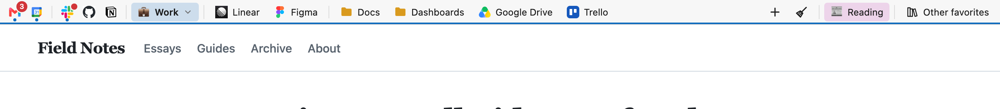
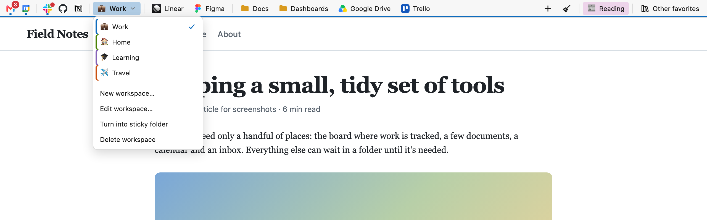
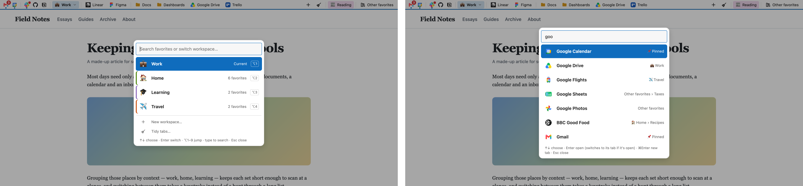
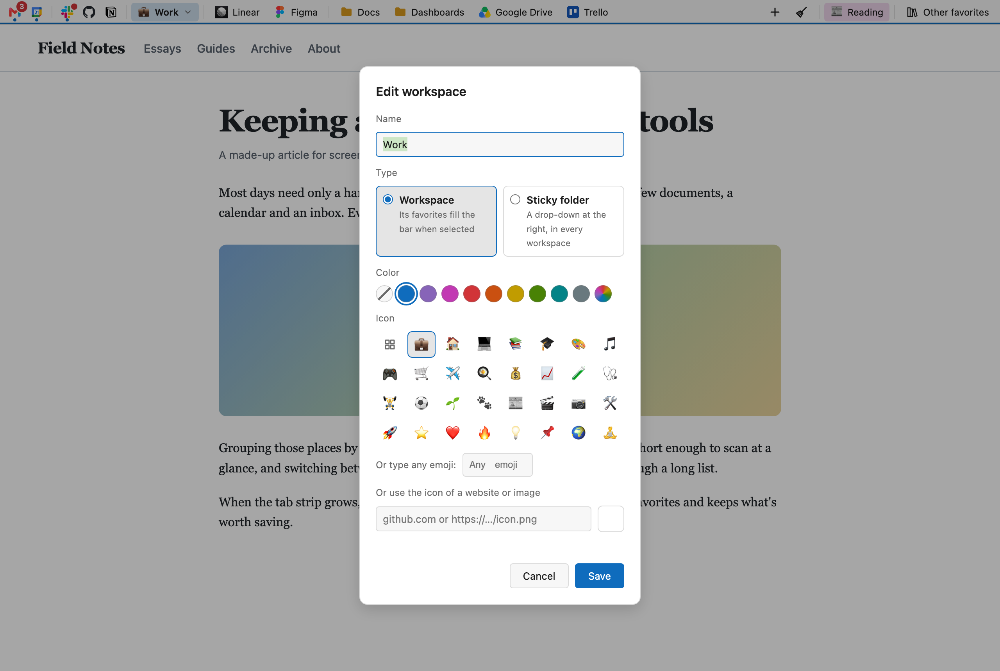
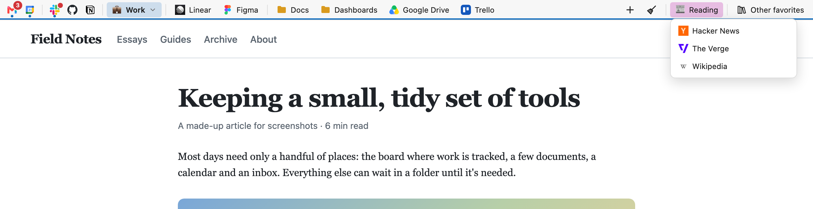
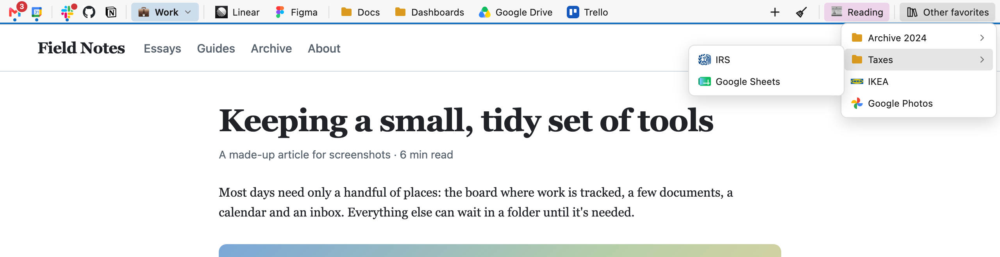
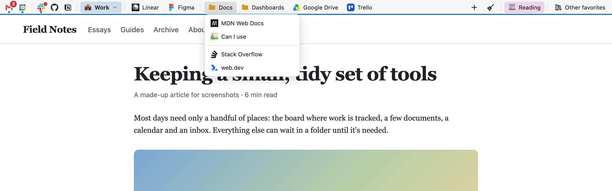
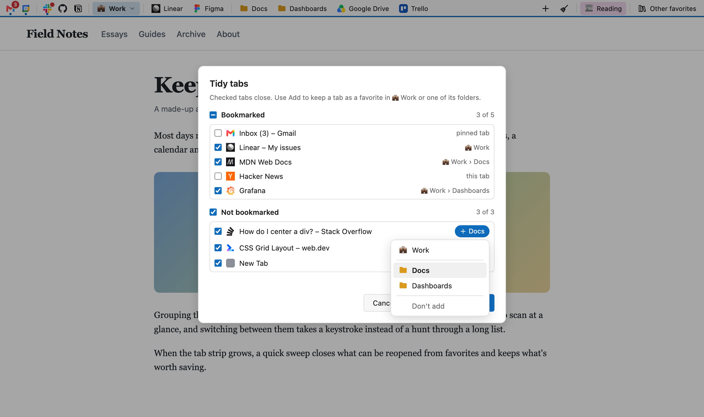
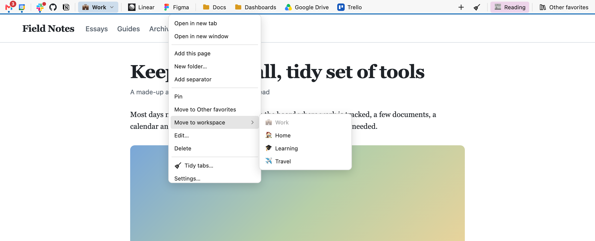
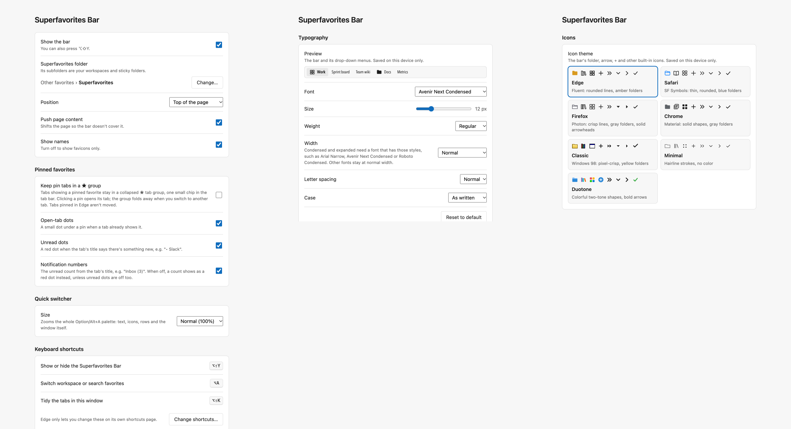

# Superfavorites Bar (Edge and Chrome extension)

Adds a second bookmarks bar to web pages, organized into **workspaces**: separate sets of favorites you switch between from the bar.

All of its favorites live in one bookmarks folder. By default that is a folder named **Superfavorites** under *Other favorites* (Edge) or *Other bookmarks* (Chrome), which the extension creates on first run. You can pick a different folder in Settings.

It works in Microsoft Edge and Google Chrome. Edge calls bookmarks *favorites*, and so does this README; in Chrome, read *bookmarks*. Browser pages are written as `edge://…`; in Chrome they're the same under `chrome://…`.



*Screenshots use a sample set of favorites, not anyone's real bookmarks.*

## Workspaces



Each subfolder of the Superfavorites folder is a workspace, and the bar shows the contents of the selected one:

```
Superfavorites
├── 💼 Work          ← workspace
│   ├── Jira
│   └── Docs/        ← an ordinary folder on the bar
└── 🏠 Home          ← workspace
    └── Netflix
```

- **Switch workspaces** with the selector at the left of the bar. The choice applies to every tab.


- **Quick switcher and search:** press **Option+A** on a Mac, or **Alt+A** elsewhere. A palette opens in the middle of the screen with a search box:
  - **With nothing typed,** it lists your workspaces. **↑ ↓** (or Tab) choose, **Enter** switches, and **Option/Alt+1–9** jump straight to one. **Option/Alt+A again** steps to the next workspace. **New workspace…** is at the bottom.
  - **Type to search** workspace names and every favorite: workspaces, sticky folders, pins and Other favorites. Names match even with letters skipped ("gcal" finds "Google Calendar"); addresses must match a continuous run of letters. Each result shows where it lives (e.g. `💼 Work › Docs`).
  - **Enter** opens the result, switching to its tab if one is already open, like a pin. **⌘/Ctrl+Enter** opens it in a new tab, and **Shift+Enter** in a new window.

  **Settings → Quick switcher → Size** zooms the whole palette, from 80% to 150%, and the palette still fits the window. You can change the shortcut at `edge://extensions/shortcuts`. Like the bar, the switcher doesn't work on the browser's own pages or the New Tab page.
- **New workspace…**, **Edit workspace…** and **Delete workspace** are in the selector's menu. Editing lets you choose a name and an icon. Right-click a workspace in the menu to edit or delete that one.


- **Colors:** choose one of the swatches or any custom color in the edit window. The selected workspace's color draws a line along the bar and tints the selector. It also marks the workspace in the selector menu and the switcher, and a sticky folder's color tints its button. The color is stored as a hidden **Workspace color** favorite pointing to `https://superfavorites.invalid/color?c=…`, so it syncs.
- **Icons** can be any of these, and all of them sync with your favorites:
  - **An emoji**, picked from the grid or typed. It is stored at the start of the folder name (`💼 Work`).
  - **A website's icon:** enter an address such as `github.com`. The extension uses the icons the page declares, or `/favicon.ico`.
  - **An image:** enter a direct link to a PNG, ICO, JPEG, GIF or WebP file. SVG isn't supported.

  For website and image icons, the URL is stored as a favorite named **Workspace icon** inside the workspace folder. The bar hides it, but you'll see it in the browser's favorites manager (`edge://favorites`, `chrome://bookmarks`). Each device downloads the image itself and keeps a small copy, so the icon shows on every site.
- **Moving favorites between workspaces:** right-click a favorite or folder and choose **Move to workspace ›**. Or drag it onto the selector, wait for the menu to open, and drop it on another workspace. Drag workspaces within that menu to reorder them.
- **First run:** the first time workspaces are turned on, everything already on the bar is moved into a workspace called **⭐ Default**, so nothing disappears.
- **Loose favorites:** a favorite placed directly in the Superfavorites folder, outside any workspace, isn't shown on the bar.
- **The browser's own folders:** if you choose the browser's own *Favorites bar* or *Other favorites* (*Bookmarks bar* or *Other bookmarks* in Chrome) as the Superfavorites folder, the extension never rearranges it. Its existing subfolders become the workspaces.

## Sticky folders



Each subfolder of the Superfavorites folder (except 📌 Pinned) is either a **workspace** or a **sticky folder**:

- **Workspace:** its favorites fill the middle of the bar when you select it in the workspace selector.
- **Sticky folder:** always shown, in every workspace, as a drop-down at the right of the bar, just before Other favorites. It shows its icon (emoji or URL icon, or a folder icon if it has none) and its name.

**Choosing:**
- In the workspace edit window, under **Type**.
- Right-click a workspace in the selector menu → **Turn into sticky folder**.
- Right-click a sticky folder on the bar → **Turn into workspace**, **Edit sticky folder…** or **Delete sticky folder**.
- Right-click an empty part of the bar → **New sticky folder…**.

There must always be at least one workspace, so the last one can't be made sticky.

**How it's stored:** a sticky folder contains a hidden favorite named **Sticky folder** pointing to `https://superfavorites.invalid/sticky`. The `.invalid` domain is reserved and never leads anywhere. Because it's a favorite, the choice syncs to your other devices. The bar never shows it, but you'll see it in the browser's favorites manager. Deleting it turns the folder back into a workspace.

## Pinned favorites

Pinned favorites appear as small favicons at the far left of the bar, before the workspace selector. They stay the same whichever workspace you're in.

- **Clicking a pin switches to a tab that already shows that page** and brings its window to the front. A new tab opens only if no tab matches.
  - **What counts as a match:** the same address (ignoring `#…` and a trailing slash), or any page under it. For example, a pin for `https://mail.google.com/` finds a Gmail tab that is already inside your inbox.
  - **When several tabs match:** an exact match wins first, then a tab in the current window, then the one you used most recently.
- **Ctrl/Cmd-click, Shift-click or middle-click** opens it in a new tab or window, as usual.
- **Status at a glance:**
  - A small **dot** under a pin means a tab already shows it, so clicking will switch rather than open.
  - A red **badge** shows unread counts read from that tab's title, e.g. `Inbox (3) – Gmail`, `(12) Slack`, `Teams [5]`.
  - A plain **red dot** means unread without a count: titles starting with `•` or `*`.

  This reflects the tabs on this device, so it isn't synced. Each of the three can be turned off in **Settings → Pinned favorites**. With numbers off, a count shows as a plain red dot.
- **Keep pin tabs in a ★ group** (Settings → Pinned favorites, off by default). Tabs showing a pinned favorite's page, however they were opened, are kept in a collapsed tab group titled ★ at the start of each window's tab bar.
  - Clicking a pin switches to its tab, which opens the group.
  - Switching to any other tab folds the group away again.
  - A tab that navigates away from the pin's site leaves the group.
  - Tabs pinned in the tab bar aren't moved, since browsers can't group pinned tabs.
  - Turning the setting off ungroups them.

  Browsers don't let extensions hide tabs completely, so the ★ chip is as small as it gets.
- **To pin:**
  - right-click a favorite and choose **Pin**;
  - right-click an empty part of the bar and choose **Pin this page**;
  - drag a favorite or a link onto the existing pins.
- **To unpin:** right-click a pin and choose **Unpin**, which moves it into the current workspace. You can also use **Move to workspace ›**, or drag it onto the bar.
- **Where they're stored:** pins live in a folder named **📌 Pinned**, next to the workspace folders. The extension recognizes it by that exact name, so renaming it turns it into an ordinary workspace. Only favorites are shown as pins, not folders.

## Other favorites



The button at the far right of the bar opens the browser's own **Other favorites** folder (**Other bookmarks** in Chrome) as a drop-down, with submenus for its folders. It's the same in every workspace. The Superfavorites folder is left out of it, wherever inside Other favorites it lives.

- **To add to it:**
  - right-click any favorite or folder and choose **Move to Other favorites**;
  - drag something onto the button (hold it there to open the menu and drop into a subfolder);
  - right-click the button and choose **Add this page here** or **New folder inside…**.
- **Its contents** work like any other favorites: Edit…, Delete, Pin, Move to workspace ›, and drag and drop. The Edit dialog's folder list includes Other favorites and its folders too.
- **If you choose Other favorites itself as the Superfavorites folder** in Settings, the button is hidden.
- **Upgrading from the "📚 Library" version:** anything in a `📚 Library` folder is moved into Other favorites, and the empty folder is removed.

## Separators



Right-click a favorite, a folder or an empty part of the bar and choose **Add separator**. That inserts a divider:
- after a favorite;
- at the end of a folder;
- at the end of the workspace.

Separators work on the bar, among the pins, and in any drop-down. Drag them to move them, and right-click one to delete it. Each is a favorite named `────────` pointing to `https://superfavorites.invalid/separator`, so it syncs and also shows (as a plain entry) in the browser's favorites manager.

## Tidy tabs



Too many tabs? **Tidy tabs** lists every tab in this window, in two groups. Tabs in other windows aren't listed; open it there to tidy them. Open it any of these ways:
- the broom button on the bar
- **Option+Shift+K** (**Alt+Shift+K** on Windows)
- **Tidy tabs…** in the bar's right-click menu
- the quick switcher, where it's at the bottom or found by typing "tidy"

**Checked tabs close.** Every tab starts checked, except three kinds you usually keep:
- the tab you're on
- tabs pinned in the tab bar
- tabs that match a pin

The two groups:
- **Bookmarked:** tabs whose address is already a favorite anywhere in the browser: Superfavorites, pins, Other favorites or the Favorites bar. Each shows where that favorite lives, so you know you can reopen it.
- **Not bookmarked:** everything else, including the browser's own pages (`edge://…`, `chrome://…`) and empty New Tab pages, which have no **Add**. Each other row has an **Add** button that opens a small menu:
  - the current workspace itself, to add the tab as a regular favorite on the bar;
  - the workspace's top-level folders;
  - **Don't add**, once something is chosen.

  The button then shows where the tab will go, e.g. **+ Docs**. Adding doesn't change the checkbox, so you can add and close, or add and keep the tab open.

The button says exactly what will happen, e.g. **Close 3 tabs · Add 2**. Favorites are added at the end of the workspace.

## Install

1. Open `edge://extensions` in Edge or `chrome://extensions` in Chrome.
2. Turn on **Developer mode** (bottom left in Edge, top right in Chrome).
3. Click **Load unpacked** and select this folder.

## Use



- **Click a favorite** to open it. Ctrl/Cmd-click or middle-click opens it in a new tab.
- **Folders** open as drop-down menus, and subfolders open as submenus. When there isn't enough room, the extra items go under **»**.
- **+** adds the current page to the bar.
- **Right-click** an item to open it in a new tab or window, open everything in a folder, or delete it. **Edit…** opens a dialog to change a favorite’s name, URL and folder, or a folder’s name and location.
- **New folder…** is in the right-click menu. Right-clicking a folder creates the new folder inside it. Right-clicking a favorite creates it right after that favorite. Right-clicking an empty part of the bar creates it at the end.
- **Drag and drop:**
  - Drag favorites and folders to reorder them.
  - Drop an item on the middle of a folder to move it inside. Hold it over the folder briefly and the folder opens, so you can drop into subfolders. Holding over **»** opens the hidden items.
  - Drag a link from any page onto the bar to save it as a favorite.
  - Drag a favorite from the bar onto a page or the address bar to use its URL.
- **Show or hide the bar** with **Alt+Shift+Y** (**Option+Shift+Y** on a Mac), or the **Show the bar** switch in the toolbar popup. While the bar is hidden, the icon shows an "off" badge.
- Changes you make anywhere in the browser's favorites, such as its favorites manager or side panel, show up on the bar right away.

## Settings



There are three ways to open the same settings, and changes take effect immediately:

- **From the bar:** right-click it and choose **Settings…** for a large settings window over the page. Close it with **Done**, **Esc** or a click outside it.
- **From the toolbar icon:** a compact popup. Its **Open in a tab** button shows the full page.
- **From the browser:** **Extension options** in the icon's right-click menu.

The settings:


- **Superfavorites folder**, whose subfolders are the workspaces. Settings shows its path; **Change…** opens a folder chooser where only the folders you open are loaded. Press ↑ ↓ to move, → ← to open and close, and Enter to choose.
- Top or bottom position
- Push page content (shifts the page so the bar doesn't cover it)
- Names or icons only
- **Keyboard shortcuts:** the current key for each command, as the browser has it. **Change shortcuts…** opens the browser's shortcuts page (`edge://extensions/shortcuts`), the only place you can change them, and the list updates when you come back.
- **Icon theme** for the bar's built-in icons: folder, submenu arrow, drop-down arrow, checkmark, », +, the default workspace icon and Other favorites. Choose from seven:
  - **Edge:** Fluent, rounded lines, amber folders.
  - **Safari:** SF Symbols, thin and rounded, blue folders.
  - **Firefox:** Photon, crisp lines, gray folders, solid arrowheads.
  - **Chrome:** Material, solid shapes, gray folders.
  - **Classic:** Windows 98, pixel-crisp, yellow folders.
  - **Minimal:** hairlines, no color.
  - **Duotone:** colorful two-tone shapes.

  The theme is saved on each device and isn't synced, so you can use a different one on each computer.
- **Typography** for the bar and its drop-down menus, with a live preview:
  - font, chosen from the fonts installed on this computer
  - size, from 10 to 18 px
  - weight
  - width
  - letter spacing
  - case: as written, small caps or UPPERCASE

  **Condensed and expanded widths** only work with a font that has those styles, such as Arial Narrow, Avenir Next Condensed or Roboto Condensed. Browsers don't squeeze other fonts. On a Mac, condensed families are often listed separately, e.g. "Avenir Next Condensed", so choosing one is the surest way to get a narrow bar. Like the icon theme, typography is saved per device.

## Limitations

- Browsers don't let extensions inject into their own pages (`edge://`, `chrome://`), the New Tab page or the extension stores, so the bar doesn't appear there.
- The bar belongs to each page, not to the browser window, so it reloads along with the page.
- Zooming a page (Ctrl/⌘ + or −) doesn't zoom the bar, its menus or its dialogs. The bar counters each tab's zoom so it keeps the same size. For a bigger or smaller bar, use **Settings → Typography**.
- Some sites have their own fixed-position header. With "push page content" turned on, that header can still sit under the bar.
- Bookmarklets (`javascript:` favorites) are shown but can't be run from the bar.

## Files

| File | Purpose |
| --- | --- |
| `manifest.json` | Extension manifest (MV3) |
| `background.js` | Service worker: reads favorites, keeps a snapshot in `chrome.storage.local`, handles the toggle and bar actions |
| `content.js` | Draws the bar inside a closed Shadow DOM on each page |
| `icon-themes.js` | The icon themes, shared by the bar and the Settings page |
| `options.html` / `options.js` | Settings page |
| `icons/` | Extension icons |
| `docs/screenshots/` | README screenshots, rendered with a sample set of favorites |
